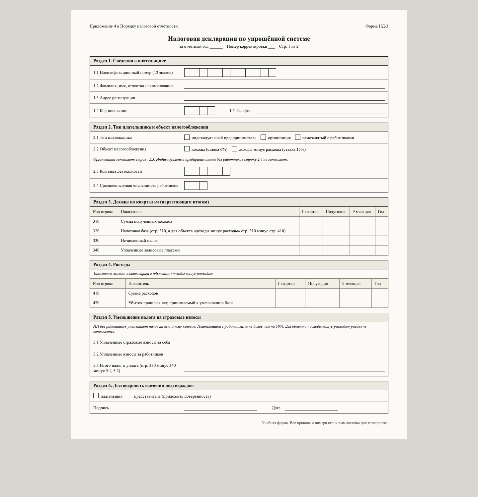
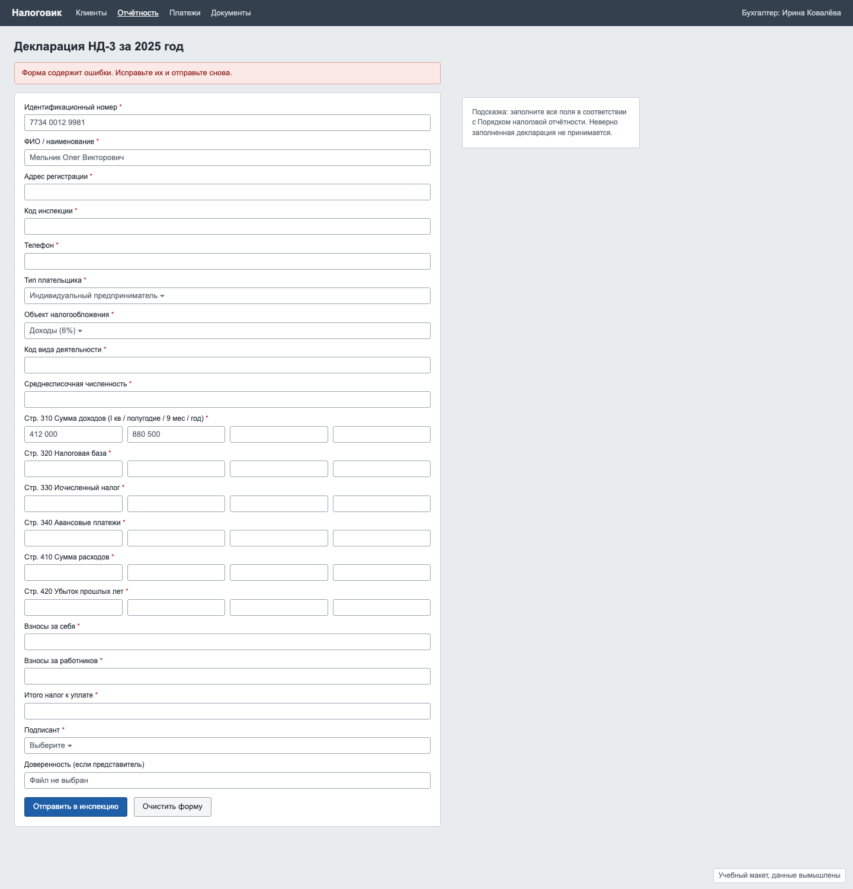

# Задача 1. Бумажная декларация → понятный визард

**Уровень:** мидл · **Таймбокс:** 1–1,5 дня · **Платформа:** десктоп-веб, 1440

> Задача основана на реальном проекте. Компания, люди, правила и цифры вымышлены для тренировки.

## Коротко

Сервис для бухгалтеров перенёс бумажную налоговую декларацию в веб один в один. Получилась длинная форма из 38 полей, где все поля обязательные, а ошибки показываются одной строкой сверху. Нужно превратить её в визард, который проведёт человека через форму и не даст ошибиться.

## Компания и продукт

**«Налоговик»**: веб-сервис для бухгалтеров на аутсорсе. Один бухгалтер ведёт 20–60 клиентов, это индивидуальные предприниматели и небольшие компании. Раз в год он сдаёт за каждого клиента декларацию НД-3.

## Кто пользуется

- **Ирина, бухгалтер на аутсорсе.** Ведёт 40 клиентов, правила формы знает наизусть. Ей нужно сдать 40 деклараций за две недели и не перепутать клиентов. Раздражает, когда интерфейс заставляет заполнять поля, которые к этому клиенту не относятся.
- **Олег, предприниматель.** Иногда сдаёт декларацию сам, без бухгалтера. Правил не знает, боится ошибиться и получить штраф.

## Как сейчас

Бумажная форма, с которой всё началось:

Текущая веб-версия. Это та же бумага, только в браузере:

## Что известно

- На бумаге есть условные правила: раздел 4 заполняют не все, строку 2.4 не заполняют ИП без работников, раздел 5 не нужен при объекте «доходы минус расходы». Веб-версия этого не учитывает и требует заполнить всё.
- Строки 320, 330 и 5.3 считаются по формулам из других строк, но в вебе их вводят руками.
- Поддержка сервиса: 38% обращений в сезон отчётности звучат как «форма не отправляется, а что не так, непонятно».
- Примерно 15% деклараций подают исправленными: в первый раз ошиблись в расчёте налога.

## Задача

Спроектируй визард заполнения декларации НД-3 для двух сценариев: бухгалтер с опытом (Ирина) и предприниматель без опыта (Олег).

## Ограничения

- Юридический состав полей менять нельзя: в инспекцию уходит та же форма.
- Поле можно скрыть, только если по правилам оно не нужно этому плательщику.
- У бухгалтера должна оставаться возможность увидеть всю декларацию целиком, как на бумаге, перед отправкой.

## Что сдать

1. Схему шагов визарда с условными ветками: какие ответы какие разделы включают и выключают.
2. Ключевые экраны: старт, 2–3 шага, экран проверки перед отправкой, успешная отправка.
3. Состояния: ошибка в поле, ошибка от инспекции после отправки, черновик, к которому вернулись через неделю.
4. Короткое объяснение решений на полстраницы: почему такие шаги и в таком порядке.

## Как поймёшь, что готово

- ИП без работников с объектом «доходы» не видит ни одного лишнего поля.
- Расчётные строки считаются сами, и понятно, из чего получилась сумма.
- По сообщению об ошибке ясно, где она и как её исправить.
- Ирина может пройти визард быстро, а Олег не потеряется.

## Если осталось время

Сеньорская версия: бухгалтеру нужно сдать 40 деклараций за раз. Как выглядит работа с пачкой клиентов, а не с одной формой?

Подсказки: [HINTS.md](HINTS.md). Открывай только после первой версии.
