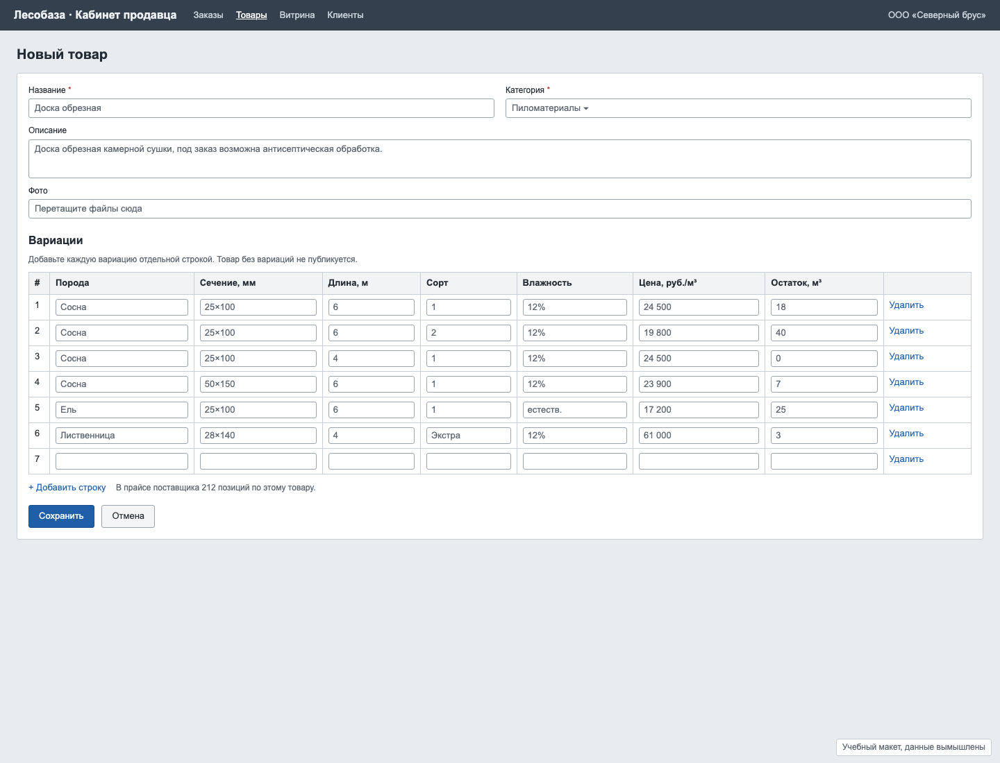
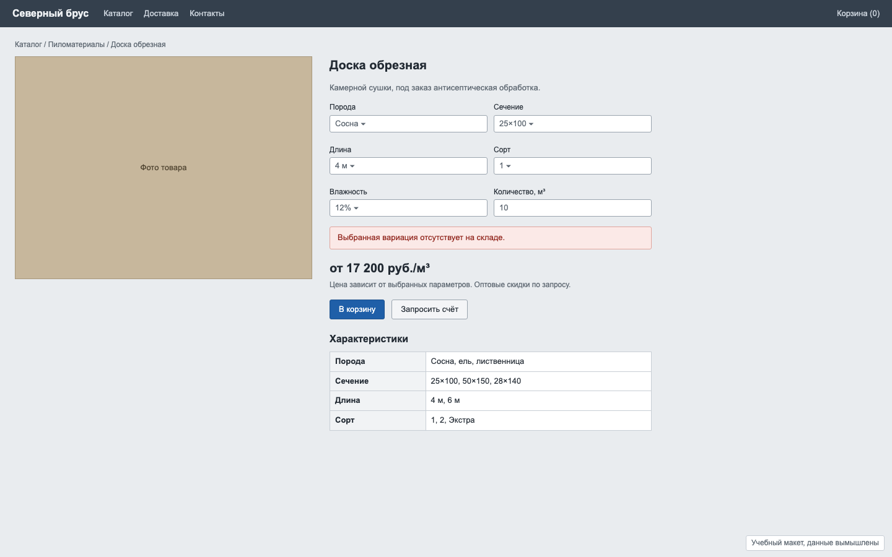

# Задача 2. Каталог с вариациями для B2B-магазина пиломатериалов

**Уровень:** мидл · **Таймбокс:** 1–2 дня · **Платформа:** десктоп-веб, 1440, плюс мобильная версия экрана покупателя

> Задача основана на реальном проекте. Компания, люди и цифры вымышлены для тренировки.

## Коротко

Платформа даёт оптовым поставщикам пиломатериалов собственный интернет-магазин. Товары у них устроены не как футболки: у одной «доски обрезной» сотни вариаций, и большая часть сочетаний не существует. Продавец сейчас вводит вариации руками по строке, а покупатель выбирает пять параметров вслепую и упирается в «нет на складе».

## Компания и продукт

**«Лесобаза»**: white-label платформа B2B-коммерции для поставщиков стройматериалов. У платформы две стороны:
- **кабинет продавца**, где поставщик ведёт каталог, цены и остатки;
- **витрина**, куда приходят покупатели: прорабы, строительные компании, мебельные цеха.

## Кто пользуется

- **Николай, менеджер поставщика «Северный брус».** Ведёт каталог из прайса в Excel на 212 позиций. Прайс меняется каждую неделю. Вводить вариации по одной строке он не будет, поэтому половина товаров сейчас просто не опубликована.
- **Марина, снабженец строительной компании.** Знает, что ей нужно: «сосна 50×150, 6 метров, второй сорт, 20 кубов». Заказывает с телефона прямо на объекте. Хочет быстро понять, есть ли это в наличии, сколько стоит и что взять взамен, если нужного нет.

## Как сейчас

Продавец создаёт товар и добавляет вариации по одной строке:

Покупатель выбирает пять параметров и только в конце узнаёт, что такого нет:

## Что известно

- Фрагмент реального прайса поставщика: [data/price-list.csv](data/price-list.csv), 23 строки из 212. Посмотри, какие сочетания есть, каких нет и какие привязаны к условиям («только 4 м», «под заказ 21 день», «минимальный заказ»).
- У лиственницы своя шкала сортов (Экстра, Прима, AB), у сосны и ели другая (1, 2). Влажность бывает не у всех пород.
- 64% карточек на витринах сейчас показывают «нет на складе» хотя бы для одной выбранной комбинации.
- Покупатели часто заказывают несколько сечений одного товара за раз.

## Задача

Спроектируй обе стороны:
1. **Продавец:** как завести товар с сотнями вариаций без ручного ввода каждой строки и как обновлять цены и остатки каждую неделю.
2. **Покупатель:** как выбрать нужную вариацию, сразу видеть наличие и цену и заказать несколько вариаций одной позиции.

## Ограничения

- Структура прайса у поставщиков разная, но у всех он есть в Excel или CSV.
- Цена указана за кубометр, а покупатели иногда считают в штуках.
- Мобильная версия нужна только для экрана покупателя.

## Что сдать

1. Модель данных товара на одну страницу: что такое товар, что такое вариация, какие параметры у неё есть.
2. Флоу продавца: создание товара, импорт вариаций из прайса, недельное обновление.
3. Карточку товара для покупателя на десктопе и на мобильном.
4. Состояния: нет в наличии, под заказ со сроком, минимальный заказ, вариация продаётся только в одной длине.

## Как поймёшь, что готово

- Продавец заводит товар с 50 вариациями за несколько минут, а не за час.
- Покупатель видит недоступные сочетания до того, как выбрал все параметры.
- Можно заказать три сечения одного товара в одной корзине.
- Разные шкалы сортов у разных пород не ломают интерфейс.

## Если осталось время

Сеньорская версия: у платформы 40 поставщиков, и каждый называет одну и ту же доску по-своему. Как покупателю сравнить предложения?

Подсказки: [HINTS.md](HINTS.md). Открывай только после первой версии.
