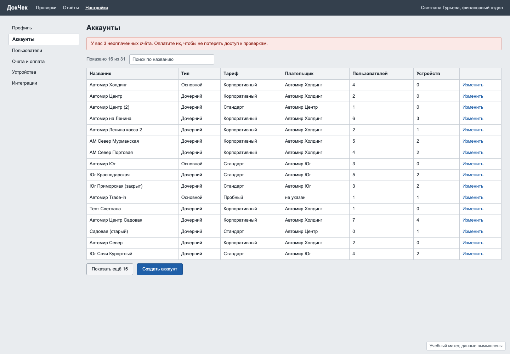
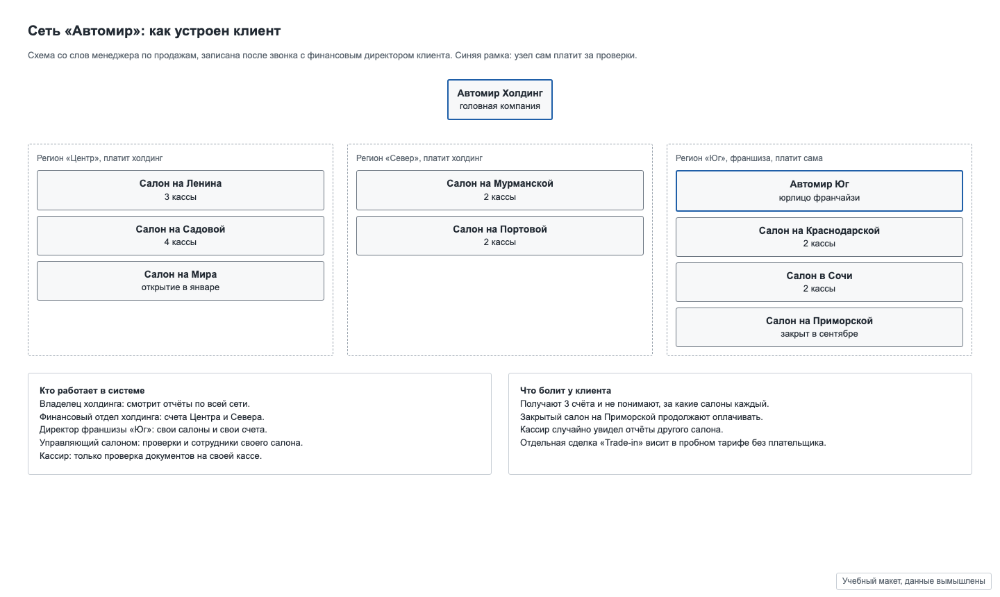

# Задача 3. Иерархия аккаунтов, биллинг и роли

**Уровень:** крепкий мидл · **Таймбокс:** 2 дня · **Платформа:** десктоп-веб, 1440

> Задача основана на реальном проекте. Компания, люди и цифры вымышлены для тренировки.

## Коротко

Сервис проверки документов продаёт подписку сетям магазинов и автосалонов. Внутри у клиента сложная структура: холдинг, регионы, салоны, кассы, франшиза со своим юрлицом. В продукте всё это хранится плоским списком «аккаунтов», и никто, включая самого клиента, не понимает, кто за что платит и кто что видит.

## Компания и продукт

**«ДокЧек»**: сервис, который проверяет паспорта и водительские права на подлинность прямо на кассе. Кассир сканирует документ, сервис отвечает «подлинный» или «есть признаки подделки». Офис клиента смотрит отчёты, управляет сотрудниками и оплачивает подписку.

## Кто пользуется

- **Светлана, финансовый отдел холдинга.** Оплачивает счета за Центр и Север. Хочет получать один понятный счёт и видеть, за какие салоны платит.
- **Андрей, директор франшизы «Юг».** Отдельное юрлицо, платит сам. Должен видеть только свои салоны.
- **Управляющий салоном.** Добавляет и убирает кассиров, смотрит проверки своего салона.
- **Кассир.** Только сканирует документы. Ни отчётов, ни денег, ни чужих салонов.

## Как сейчас

Экран аккаунтов глазами Светланы. 31 аккаунт плоским списком, дубли, тестовые записи, закрытые салоны:

Как клиент устроен на самом деле, со слов отдела продаж:

## Что известно

- У клиента 3 региона, 8 салонов (один закрыт, один откроется в январе), 15 касс в работающих салонах и отдельная пробная сделка «Trade-in» без плательщика.
- Холдинг платит за Центр и Север. Франшиза «Юг» платит сама.
- Клиент получает 3 счёта в месяц и в поддержку пишет «за что этот счёт».
- В прошлом месяце кассир увидел отчёты другого салона, потому что ему по ошибке выдали роль «управляющий».
- Тарифы считаются за кассу (устройство) в месяц.

## Задача

Спроектируй, как клиент со сложной структурой видит свою организацию, управляет доступами и понимает, за что платит.

## Ограничения

- Юридически холдинг и франшиза разные компании: франшиза не видит финансы холдинга, а холдинг видит отчёты франшизы только по проверкам, без её счетов.
- Миграция: 31 существующий аккаунт нужно превратить в новую структуру без потери истории проверок.
- Кассир работает на устройстве на кассе, его интерфейс не меняется.

## Что сдать

1. **Матрицу «роль × действие»** до экранов: кто что видит и может делать.
2. Экран структуры организации глазами Светланы и глазами Андрея.
3. Флоу: открыть новый салон, закрыть салон, перевести салон в другой регион.
4. Экран счетов: из чего складывается сумма, за какие салоны и кассы.
5. Что видит человек, у которого нет прав на раздел.

## Как поймёшь, что готово

- Светлана за минуту отвечает на вопрос «почему в этом месяце счёт больше».
- Андрей не видит ничего, что относится к холдингу, кроме общей структуры сети.
- Закрытый салон перестаёт попадать в счёт, а история его проверок остаётся.
- Пользователь без прав понимает, к кому обратиться, а не видит пустую страницу.

## Если осталось время

Сеньорская версия: в продукте 200 таких клиентов, и у каждого своя структура. Какая модель (жёсткие уровни «холдинг, регион, салон» или гибкое дерево) подойдёт бизнесу и сколько стоит каждый вариант?

Подсказки: [HINTS.md](HINTS.md). Открывай только после первой версии.
