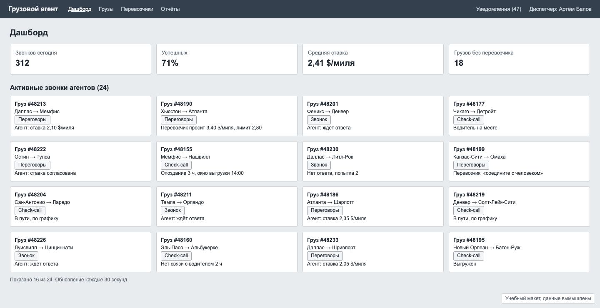
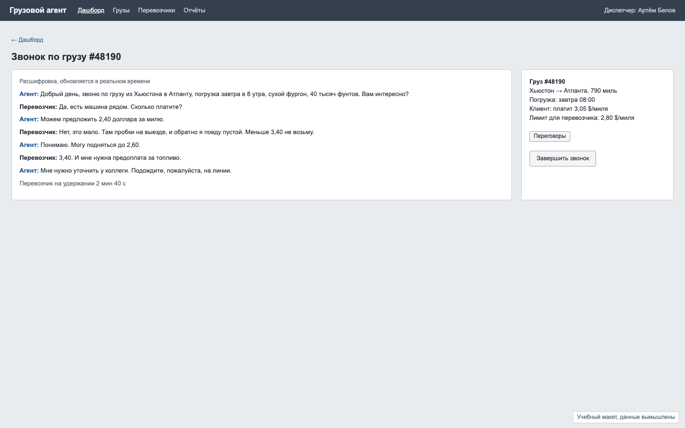

# Задача 4. «Требует вашего внимания»: диспетчер и AI-агенты

**Уровень:** крепкий мидл · **Таймбокс:** 2 дня · **Платформа:** десктоп-веб, 1440, широкий монитор

> Задача основана на реальном проекте. Компания, люди и цифры вымышлены для тренировки.

## Коротко

В логистической компании звонки перевозчикам теперь делают AI-агенты: ищут машину под груз, торгуются о ставке, звонят водителям узнать, где они. Человек-диспетчер должен вмешиваться только там, где агент не справляется. Сейчас диспетчер видит стену из одинаковых карточек и пропускает то, что горит.

## Компания и продукт

**«Грузовой агент»**: платформа для брокеров грузоперевозок в США. Брокер получает груз от клиента и ищет перевозчика, который его повезёт. Разница между ставкой клиента и ставкой перевозчика и есть заработок брокера.

AI-агент делает три типа звонков:
- **Поиск перевозчика и переговоры** о ставке за милю.
- **Check-call:** звонок водителю в пути, «где вы и успеваете ли к окну выгрузки».
- **Повторные звонки**, если никто не ответил.

## Кто пользуется

- **Артём, диспетчер.** Одновременно отвечает за 20–40 активных грузов. Раньше звонил сам, теперь наблюдает за агентами. Боится двух вещей: что агент согласует ставку себе в убыток и что груз опоздает, а он узнает об этом от клиента.

## Как сейчас

Дашборд: четыре счётчика сверху и одинаковые карточки звонков. Найди, где на самом деле нужна помощь человека:

Карточка звонка: перевозчик просит больше лимита, агент поставил его на удержание, а у диспетчера одна кнопка «Завершить звонок»:

## Что известно

- В среднем из 24 активных звонков помощь человека нужна в 3–5.
- Ситуации, которые требуют человека:
  - перевозчик просит ставку выше лимита (ждёт на линии, каждая минута на удержании снижает шанс сделки);
  - перевозчик просит «соединить с человеком»;
  - водитель опаздывает к окну выгрузки;
  - нет связи с водителем больше часа;
  - груз без перевозчика, а до погрузки меньше 12 часов.
- Остальное агент делает сам: ждёт ответа, согласует ставку в пределах лимита, фиксирует «в пути, по графику».
- Уведомлений за смену приходит около 300, и диспетчер их не читает.

## Задача

Спроектируй рабочее место диспетчера, где главное: то, что требует его решения сейчас. И экран вмешательства в звонок, где он может принять решение за секунды.

## Ограничения

- Агент не может превышать лимит ставки без разрешения человека.
- Диспетчер может: разрешить ставку выше лимита, предложить свою ставку агенту, взять звонок на себя, отклонить перевозчика.
- Экран открыт весь день на большом мониторе, рядом с почтой и телефоном.

## Что сдать

1. Список ситуаций, которые требуют внимания, с приоритетом и объяснением, почему такой порядок.
2. Главный экран диспетчера.
3. Экран вмешательства в звонок с переговорами.
4. Состояния: всё спокойно (ничего не требует внимания), пять срочных ситуаций одновременно, диспетчер отошёл на 20 минут и вернулся.
5. Что происходит с уведомлениями: какие остаются, какие исчезают.

## Как поймёшь, что готово

- За 3 секунды ясно, есть ли сейчас что-то срочное.
- Из алерта можно сразу принять решение, не открывая три экрана.
- Обычная работа агентов видна, но не отвлекает.
- Видно, сколько перевозчик уже ждёт на линии.

## Если осталось время

Сеньорская версия: агентов становится больше, и на одного диспетчера приходится 100 грузов. Что должно измениться в роли диспетчера и в продукте?

Подсказки: [HINTS.md](HINTS.md). Открывай только после первой версии.
