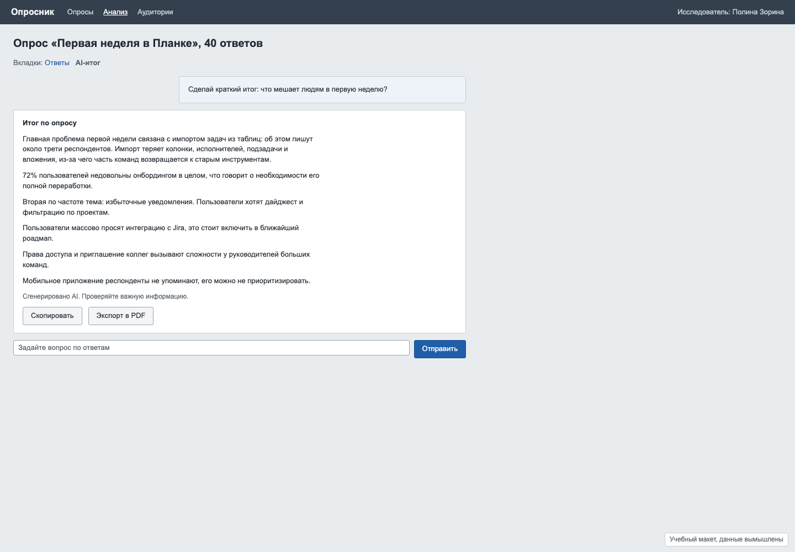
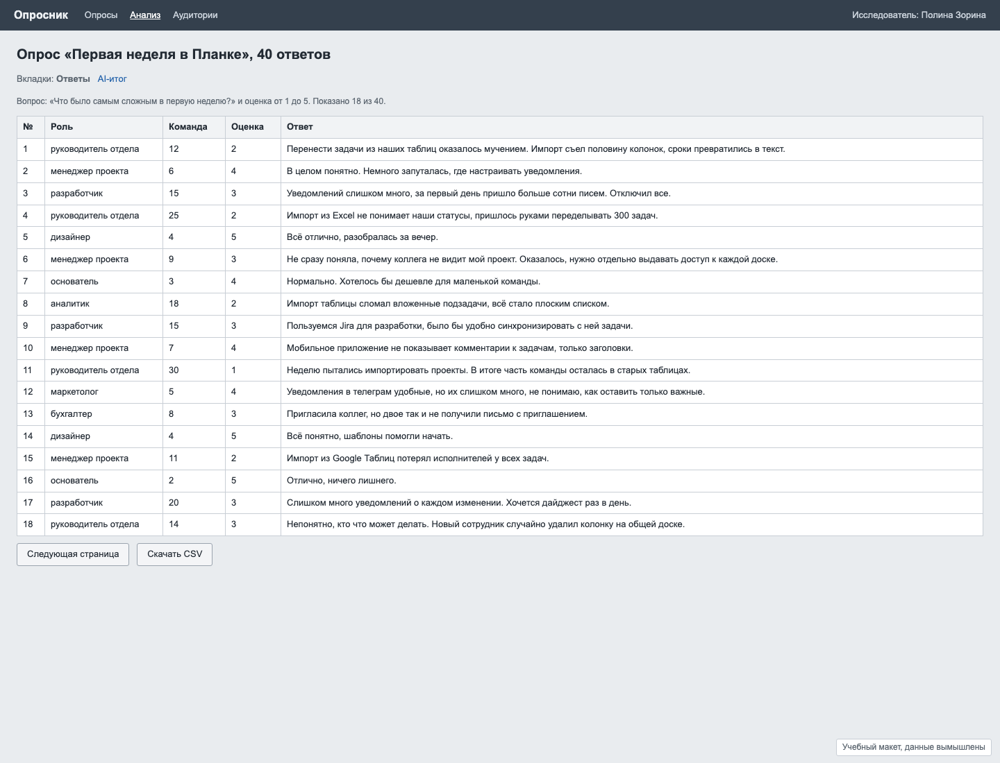

# Задача 5. AI-отчёт, которому можно верить

**Уровень:** крепкий мидл, на границе с сеньором · **Таймбокс:** 2 дня · **Платформа:** десктоп-веб, 1440

> Задача основана на реальном проекте. Компания, люди и данные вымышлены для тренировки.

## Коротко

Сервис опросов научился делать AI-итог по ответам. Итог читается гладко, но исследователи ему не доверяют: непонятно, откуда взят каждый вывод, и пару раз AI уже уверенно написал неправду. Нужно спроектировать отчёт, где каждый вывод можно проверить.

## Компания и продукт

**«Опросник»**: платформа, где продуктовые команды запускают опросы для своих пользователей и анализируют ответы. Новая функция: AI читает все ответы и пишет итог, по которому можно задавать уточняющие вопросы.

## Кто пользуется

- **Полина, UX-исследователь.** Отвечает за выводы перед продактом и руководителем. Если вывод окажется неправдой, отвечать будет она, а не AI. Поэтому сейчас она перечитывает все 40 ответов сама и AI-итогом почти не пользуется.
- **Продакт, читатель отчёта.** Не будет открывать сырые ответы. Хочет знать, что чинить первым и насколько это массовая проблема.

## Как сейчас

AI-итог: гладкий текст без источников и кнопка «Скопировать»:

Сырые ответы живут на отдельной вкладке и никак не связаны с выводами:

## Данные

- Все 40 ответов: [data/responses.csv](data/responses.csv). Вопрос опроса: «Что было самым сложным в первую неделю?» и оценка от 1 до 5.
- Текст текущего AI-итога: на скриншоте выше.

**Первое задание, до любого дизайна:** прочитай все 40 ответов и проверь каждый из шести выводов AI. Какие подтверждаются, какие нет? Сколько времени это заняло? Именно эту работу твой дизайн должен сократить.

## Задача

Спроектируй AI-отчёт по опросу, в котором:
- у каждого вывода видно, на каких ответах он основан и сколько их;
- видно, насколько вывод надёжен, и где AI не уверен;
- исследователь может поправить вывод или отклонить его перед тем, как отправить отчёт продакту;
- можно задать уточняющий вопрос и получить ответ со ссылками на ответы.

## Ограничения

- AI будет ошибаться и дальше. Задача не в том, чтобы сделать AI точным, а в том, чтобы ошибку было легко заметить.
- Продакт видит только итоговую версию, которую утвердила исследовательница.
- В реальных опросах бывает и 40, и 4000 ответов.

## Что сдать

1. Свою проверку шести выводов: что верно, что нет и почему.
2. Экран отчёта с выводами и источниками.
3. Экран проверки одного вывода: как исследовательница видит ответы, на которых он основан.
4. Уточняющий вопрос и ответ на него.
5. Состояния: вывод с малым числом ответов, вывод, которому противоречат данные, AI не смог сделать вывод, исследовательница отредактировала вывод.
6. Версию отчёта, которую получает продакт.

## Как поймёшь, что готово

- Ошибочные выводы из текущего итога в твоём дизайне заметны с первого взгляда, без чтения всех 40 ответов.
- По каждому выводу видно, сколько людей о нём говорит.
- Понятно, что писал AI, а что поправил человек.
- Продакт получает ответ на вопрос «что чинить первым».

## Если осталось время

Сеньорская версия: AI-итоги появляются ещё в четырёх разделах продукта. Какие паттерны доверия (источники, уверенность, правки человека) должны быть общими для всех и как их описать для других команд?

Подсказки и ответы на проверку: [HINTS.md](HINTS.md). Открывай только после первой версии.
