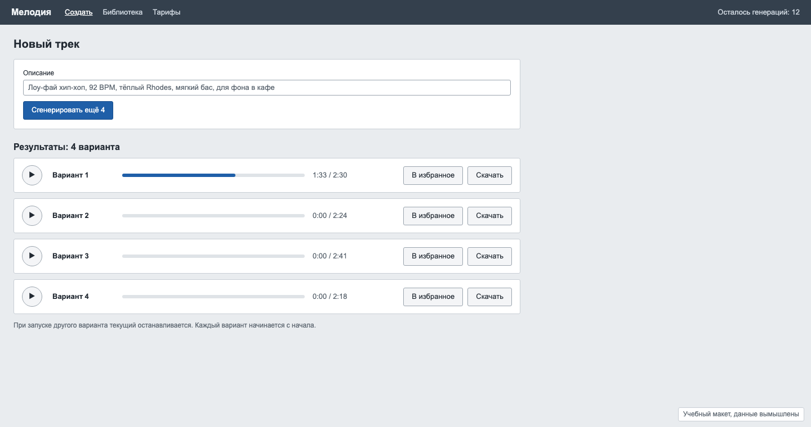

# Задача 6. Выбрать лучший из четырёх AI-вариантов мелодии

**Уровень:** мидл · **Таймбокс:** 1 день · **Платформа:** десктоп-веб, 1440

> Задача из открытого личного проекта автора репозитория. Живая версия есть, ссылка в подсказках. Открывай её только после своей.

## Коротко

Генератор музыки по одному описанию выдаёт четыре варианта. Чтобы выбрать лучший, человек включает каждый с начала и пытается вспомнить, как звучал предыдущий. К четвёртому варианту первый уже забыт. Нужен интерфейс, в котором варианты можно честно сравнить.

## Кто пользуется

- **Даша, монтажёр роликов для соцсетей.** Делает 3–4 ролика в день, под каждый генерирует фоновую музыку. На выбор трека у неё 5 минут. Ей важно, чтобы музыка держала ритм монтажа и не перебивала голос.
- **Лёша, музыкант.** Использует генерации как черновики. Слушает внимательно: аранжировку, бас, как звучит переход между частями. Замечает, что громкий вариант всегда кажется лучше, даже если он хуже.

## Как сейчас

## Что известно

- Все четыре варианта сгенерированы по одному описанию, в одном темпе (в примере 92 BPM) и примерно одной длины, 2:18–2:41.
- Если включить другой вариант, текущий останавливается, а новый начинается с 0:00.
- Варианты различаются по громкости до 4–5 дБ. Люди почти всегда выбирают более громкий.
- Варианты называются «Вариант 1–4», и первый слушают чаще остальных просто потому, что он первый.
- Генерация стоит денег: у Даши остаётся 12 генераций в месяце.

## Задача

Спроектируй экран сравнения четырёх вариантов одного трека, на котором можно услышать разницу в одном и том же месте композиции, быстро переключаться и принять решение.

## Ограничения

- Звук играет только один: слушать четыре трека одновременно нельзя.
- Экран должен работать с клавиатуры: у монтажёров руки на клавиатуре.
- Дизайн без звука не проверить. Опиши словами, что слышит человек при каждом действии.

## Что сдать

1. Экран сравнения в основном состоянии, во время воспроизведения.
2. Что происходит при переключении варианта: в какой момент меняется звук и как это видно.
3. Как человек отмечает понравившиеся и отброшенные варианты и что получает в итоге.
4. Состояния: ничего не играет, один вариант ещё генерируется, один вариант не сгенерировался, все варианты отброшены.
5. Схему клавиатурных сочетаний.

## Как поймёшь, что готово

- Можно сравнить припев во всех четырёх вариантах, не перематывая каждый вручную.
- Громкость не влияет на выбор, или пользователь хотя бы видит, что варианты звучат с разной громкостью.
- Порядок вариантов не подталкивает к первому.
- Даша выбирает трек за пару минут, Лёша может вслушаться в детали.

## Если осталось время

Сеньорская версия: такой же выбор нужен для картинок и видео в том же продукте. Что из твоего решения общее для любого медиа, а что только для звука?

Подсказки и живая версия: [HINTS.md](HINTS.md). Открывай только после первой версии.
