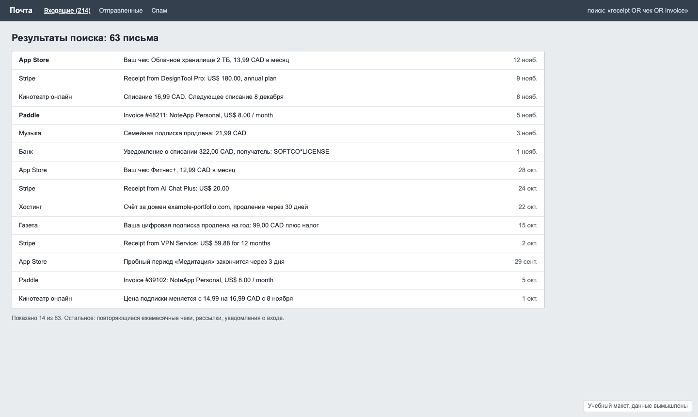

# Задача 7. Подписки: что продлится, сколько стоит и от чего отказаться

**Уровень:** мидл · **Таймбокс:** 1–1,5 дня · **Платформа:** десктоп-веб, 1440, и мобильная версия главного экрана

> Задача из личного проекта автора репозитория. Репозиторий закрытый, поэтому данные заменены на вымышленные, а живой версии для сравнения нет.

## Коротко

Подписки списываются письмами от десятка разных сервисов. Годовая подписка за 322 CAD приходит без предупреждения, а сервисы, которыми давно не пользуешься, продолжают списывать деньги. Нужен экран, который показывает, что и когда спишется, и помогает решить, что отменить.

## Кто пользуется

- **Один человек, для себя.** У него 12 подписок в двух валютах (CAD и USD), часть помесячно, часть раз в год. Он не бухгалтер и не хочет вести таблицу. Открывает экран раз в неделю или когда пришло непонятное списание.

## Как сейчас

Почта, в которой чеки перемешаны с рассылками:

## Данные

[data/subscriptions.csv](data/subscriptions.csv): 12 подписок, уже собранных из чеков. В данных специально есть сложные случаи:
- цены в двух валютах, часть с налогом в цене, часть без;
- годовые и месячные планы рядом;
- последнее использование известно не для всех: для сервисов на телевизоре и телефоне сигнала нет вообще;
- списание в банке, для которого не нашёлся чек;
- пробный период, про который неизвестно, отменён ли он;
- подписка, у которой выросла цена;
- домен, которым не «пользуются», но который нужен.

## Задача

Спроектируй экран подписок, который отвечает на три вопроса:
1. Что спишется в ближайшие 30 дней и на какую сумму?
2. Сколько всё это стоит за год?
3. От чего можно отказаться?

## Ограничения

- Данные об использовании приходят только с ноутбука: история браузера и запуск приложений. Телефон и телевизор продукт не видит.
- Продукт не умеет отменять подписки сам, он может только подсказать, где это сделать.
- Это личные финансы: экран не должен быть публичным и не должен показывать суммы в уведомлениях на заблокированном экране.

## Что сдать

1. Главный экран на десктопе и на мобильном.
2. Карточку или строку подписки во всех состояниях из данных.
3. Как выглядит «кандидат на отмену» и почему продукт так решил.
4. Прогноз на 12 месяцев: в какие месяцы будет дорого.
5. Состояния: первая загрузка, пока чеки не разобраны; найдено списание без чека; данные давно не обновлялись.

## Как поймёшь, что готово

- За 10 секунд понятно, сколько денег уйдёт в этом месяце.
- Месячные и годовые подписки сравнимы между собой.
- Сервис без сигнала об использовании не помечен как «не используется».
- Видно, в какой валюте списание и включён ли налог.

## Если осталось время

Сеньорская версия: такой продукт хотят сделать для семьи из четырёх человек с общими и личными подписками. Что меняется в модели данных и в приватности?

Подсказки: [HINTS.md](HINTS.md). Открывай только после первой версии.
