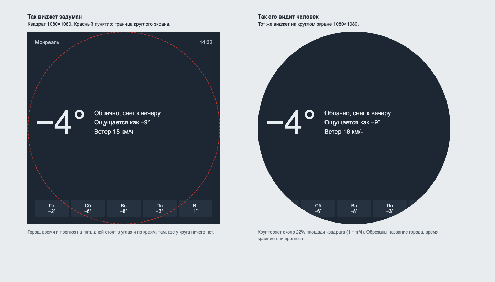

# Задача 8. Мини-приложения для круглого экрана

**Уровень:** мидл · **Таймбокс:** 1–1,5 дня · **Платформа:** круглый сенсорный экран 1080×1080

> Задача из открытого личного проекта автора репозитория. Живая версия есть, ссылка в подсказках. Открывай её только после своей.

## Коротко

Домашние умные часы на Raspberry Pi с круглым сенсорным экраном. На них работают маленькие приложения: часы, погода, таймер, список дел. Все привычные интерфейсы нарисованы для прямоугольника, а у круга нет углов: он теряет около 22% площади квадрата. Нужно спроектировать три приложения так, чтобы они родились круглыми, а не были обрезанными прямоугольниками.

## Устройство

- Экран круглый, 1080×1080 пикселей, диаметр около 12 см, сенсорный.
- Стоит на кухне, на столе или на полке. Смотрят на него с расстояния 1–3 метра, трогают на расстоянии вытянутой руки.
- Кнопок нет, только касания и свайпы.
- Приложения переключаются свайпом по горизонтали.

## Кто пользуется

- **Семья из трёх человек.** Утром смотрят погоду и время, пока собираются. Днём ставят таймер, когда готовят: руки часто мокрые или в муке. Вечером проверяют, что осталось в списке дел.

## Как сейчас

Типичный виджет погоды, нарисованный для квадрата, и что от него остаётся на круге:

## Задача

Спроектируй три мини-приложения для этого экрана:
1. **Погода:** сейчас и на ближайшие дни.
2. **Таймер:** поставить, увидеть, сколько осталось, услышать и выключить, когда закончился.
3. **Список дел:** посмотреть, отметить выполненное, увидеть, что уже сделано.

## Ограничения

- Ничего важного ближе 60 px к краю круга: там палец промахивается, а текст читается плохо.
- Главная цифра или надпись читается с 3 метров.
- Таймер, который закончился, должен быть слышен и виден поверх любого другого приложения.
- Ввода с клавиатуры нет. Новые дела добавляются с телефона, на часах их только отмечают.

## Что сдать

1. Сетку или правила раскладки для круга: где безопасная зона, где главное, где второстепенное.
2. Три приложения в основном состоянии.
3. Таймер: установка, идёт отсчёт, закончился и звонит поверх другого приложения.
4. Список дел: пустой, 3 дела, 15 дел, всё сделано.
5. Погода: обычный день и день с предупреждением о погоде.

## Как поймёшь, что готово

- Ни один элемент не обрезан краем круга.
- Время на таймере читается с другого конца кухни.
- Таймер можно поставить на 10 минут одной рукой за пару касаний.
- Длинный список дел не превращается в мелкий текст.

## Если осталось время

Сеньорская версия: таких устройств в доме четыре, у них разное железо, и каждое показывает свой набор приложений. Как устроена настройка всех устройств сразу?

Подсказки и живая версия: [HINTS.md](HINTS.md). Открывай только после первой версии.
