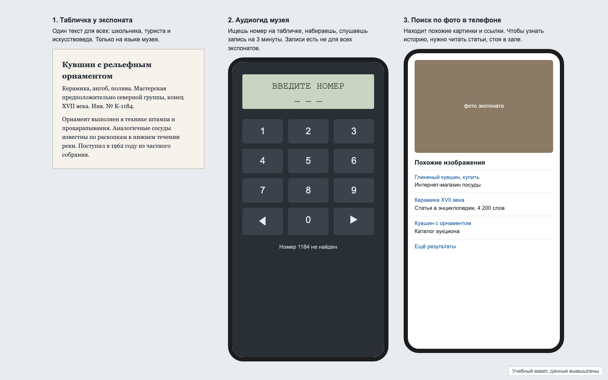

# Задача 9. AI-гид по музею: навёл камеру и слушаешь

**Уровень:** мидл · **Таймбокс:** 1,5–2 дня · **Платформа:** мобильное приложение, 390×844

> Задача из открытого личного проекта автора репозитория. Исходники и скриншоты есть, ссылка в подсказках. Открывай их только после своей версии.

## Коротко

Посетитель стоит у экспоната и хочет узнать его историю на своём языке и настолько подробно, насколько ему интересно. Табличка написана одна для всех, аудиогид есть не для всех экспонатов, а поиск по фото выдаёт ссылки на магазины. Идея приложения: навёл телефон на экспонат, приложение узнало его, написало рассказ под тебя и прочитало вслух, чтобы телефон можно было убрать в карман.

## Кто пользуется

- **Анна, туристка.** Не говорит на языке музея. Хочет коротко: что это и почему это важно. Ходит по залу 40 минут и видит 60 экспонатов.
- **Игорь, любитель истории.** Готов слушать 5 минут про один предмет. Хочет задать вопрос: «А почему орнамент именно такой?»
- **Семья с ребёнком 9 лет.** Ребёнку нужно другое объяснение, чем взрослым.

## Как сейчас

Три способа, которыми посетитель узнаёт об экспонате сегодня:

## Что известно

- В залах часто плохой интернет и приглушённый свет.
- В кадр попадает несколько экспонатов сразу, а витрина даёт блики.
- Распознавание и генерация рассказа занимают 3–8 секунд.
- Узнавание иногда ошибается: путает похожие предметы из одной коллекции.
- Посетители ходят в наушниках или без них, в зале нельзя громко.

## Задача

Спроектируй основной цикл приложения: снять экспонат, получить рассказ, слушать с телефоном в кармане, задать вопрос, перейти к следующему экспонату.

## Ограничения

- Первая версия работает только по фото, без видео в реальном времени.
- Человек должен один раз выбрать язык и глубину рассказа, а не каждый раз.
- Если приложение не уверено, что узнало экспонат, оно не должно рассказывать уверенно.

## Что сдать

1. Онбординг: язык, глубина рассказа, интересы. Не дольше 30 секунд.
2. Цикл: съёмка, ожидание, рассказ, прослушивание.
3. Экран рассказа: текст, озвучка, вопрос к гиду.
4. Состояния: не узнал, узнал неуверенно (два варианта), в кадре несколько экспонатов, нет сети, рассказ ещё генерируется.
5. Как выглядит история посещения: что я уже посмотрел сегодня.

## Как поймёшь, что готово

- От съёмки до звука проходит не больше двух касаний.
- Ожидание в 5 секунд не выглядит как зависание.
- Если приложение ошиблось, человек это видит и может поправить.
- Анна и Игорь получают разные рассказы об одном экспонате, и каждый доволен своим.

## Если осталось время

Сеньорская версия: приложение хотят продавать музеям, и каждый музей хочет свой стиль и свои маршруты. Что настраивает музей, а что остаётся общим?

Подсказки и исходники: [HINTS.md](HINTS.md). Открывай только после первой версии.
