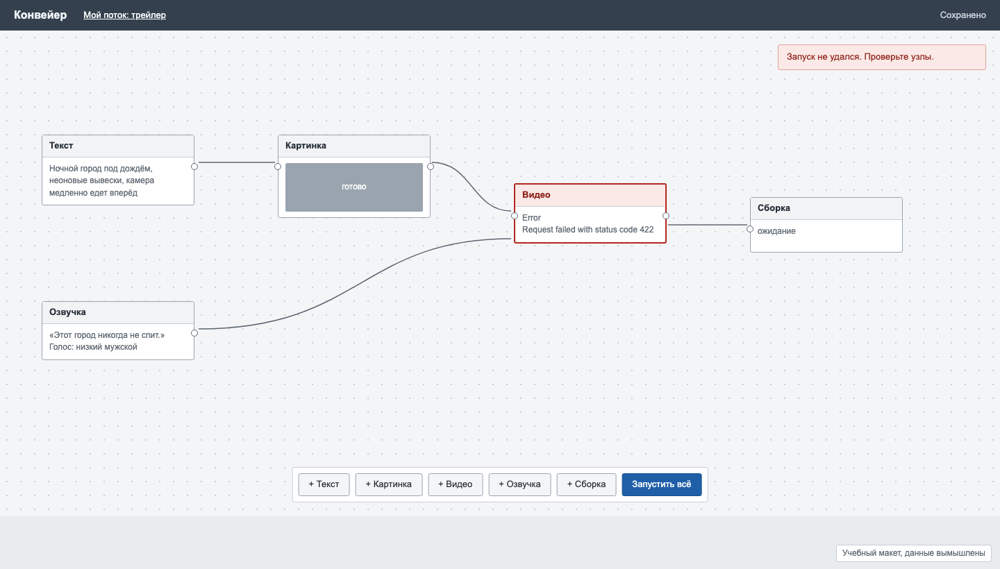

# Задача 10. Ошибки и запуск в редакторе из узлов

**Уровень:** крепкий мидл · **Таймбокс:** 2 дня · **Платформа:** десктоп-веб, 1440

> Задача из открытого личного проекта автора репозитория. Живая версия есть, ссылка в подсказках. Открывай её только после своей.

## Коротко

В редакторе люди собирают конвейер генерации медиа из узлов: текст превращается в картинку, картинка в видео, отдельно делается озвучка, в конце всё собирается в ролик. Пока всё работает, редактор удобный. Когда что-то ломается, человек видит красный узел с «Error 422» и не понимает, что делать.

## Кто пользуется

- **Вика, моушн-дизайнер.** Собирает тизеры из генераций. Не программист. Поток из 5–12 узлов, один запуск длится 2–6 минут и стоит денег.
- **Кирилл, продюсер.** Запускает потоки, которые собрала Вика, меняя только текст. Если что-то упало, он не будет разбираться в узлах, ему нужно понять, его ли это проблема.

## Как сейчас

Поток упал на узле «Видео»:

## Что известно

- У каждого выхода и входа узла есть тип: текст, картинка, видео, аудио.
- Узлы выполняются по порядку зависимостей: узел запускается, когда готовы все его входы.
- Ошибки бывают разные: неверный тип данных на входе, сервис генерации недоступен, кончились деньги на счёте, генерация отклонена фильтром контента, превышено время ожидания.
- Можно запустить весь поток или один узел.
- Без ключей доступа к сервисам редактор работает в демо-режиме и выдаёт заглушки вместо медиа.

## Задача

Спроектируй, как редактор показывает ход выполнения и ошибки и как помогает их исправить, не теряя уже готовые результаты.

## Ограничения

- Повторный запуск всего потока стоит денег и времени. Готовые узлы не должны пересчитываться без нужды.
- Кирилл не должен видеть технические подробности, Вике они иногда нужны.
- Редактор работает в браузере, поток сохраняется локально.

## Что сдать

1. Типы входов и выходов: как их видно на узле и что происходит при попытке соединить несовместимые.
2. Ход выполнения: какой узел ждёт, какой идёт, какой готов, сколько осталось.
3. Ошибки: по одному экрану на каждый тип из списка выше, с тем, что человеку делать дальше.
4. Повторный запуск после исправления.
5. Демо-режим: как человек понимает, что видит заглушки, а не настоящий результат.

## Как поймёшь, что готово

- По ошибке понятно, кто должен её исправить: Вика, Кирилл или никто, потому что сервис лежит.
- Несовместимое соединение нельзя сделать случайно.
- После исправления запускаются только нужные узлы.
- Заглушку невозможно принять за готовый ролик.

## Если осталось время

Сеньорская версия: потоки Вики хотят превратить в шаблоны, которые Кирилл и ещё десять человек запускают без редактора, через простую форму. Что меняется в продукте?

Подсказки и живая версия: [HINTS.md](HINTS.md). Открывай только после первой версии.
